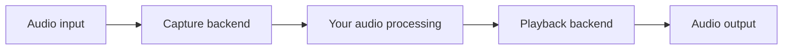

# mka-core-audio

**mka-core-audio** is a C++ library for real-time audio input and output. It gives
applications a common interface to different audio systems, making it suitable
for DAWs, synthesizers, audio effects and other sound applications.

The goal is to keep your audio processing code independent of the operating
system and audio backend.

## How it works

The library discovers audio devices, opens streams and delivers audio buffers to
your processing callback. Your application handles the sound processing; the
backend handles communication with the operating system.

Audio is supplied as Float32 buffers, one per channel. Backends handle conversion
to and from native device formats. Stream setup and resource management stay
outside the audio callback, which uses preallocated buffers.

## Backend support

| Operating system | Backend | Status |
| --- | --- | --- |
| Linux | ALSA | Supported |
| Linux | JACK | Supported |
| Linux | PipeWire | Supported |
| Linux | PulseAudio | Supported |
| Windows | WASAPI (shared mode) | Supported |
| Windows | WASAPI (exclusive mode) | Not yet supported |
| Windows | ASIO | Planned |
| Windows | DirectSound | Planned |
| Windows | WMME | Planned |
| macOS | Core Audio | Planned |

Planned backends are not yet supported. Available input/output modes and formats
depend on the backend and device.

## Documentation

The project uses C++ modules and CMake. For specifications, validation details
and hands-on audio tests, see:

- Specifications: [English](doc/specifications_en.md) / [Français](doc/specifications_fr.md)
- [Linux backend validation](docs/sprint03-validation.md)
- [Windows WASAPI validation](docs/sprint05-validation.md)
- [Manual ALSA audio tests](docs/manual-alsa.md)
- [Manual WASAPI audio tests](docs/manual-wasapi.md)
