# mka-core-audio

**mka-core-audio** is a C++ real-time audio framework designed to provide a **backend-agnostic, low-latency audio layer** for professional audio applications such as digital audio workstations (DAWs), synthesizers, audio plugins and signal-processing software.

The public C++ API lives in `mka::audio::core`. Import `mka.audio.backend.abstract` for the backend contract and its re-exported endpoint, process, constants and error types.

The project is built around one central idea:

> **Hide platform and audio-backend differences behind a small, predictable and real-time-safe C++ interface.**

The framework is intended to become the audio foundation of a future DAW and other audio software developed within the MKA ecosystem.

---

## Goals

The main goals of the project are:

* Low-latency real-time audio processing
* Cross-platform architecture
* Backend-independent public API
* Unified input/output endpoint model
* Strict separation between control and real-time audio code
* No dynamic allocation in the real-time processing path
* Backend-provided processing lengths, independent of DSP block sizes
* Support for different backend buffer sizes
* Unified floating-point audio buffers at the framework level
* Minimal and predictable API
* Modern C++ architecture using C++ modules

The framework is deliberately designed to avoid exposing backend-specific concepts to the rest of the application.

---

## Architecture

The framework is organized into several layers.

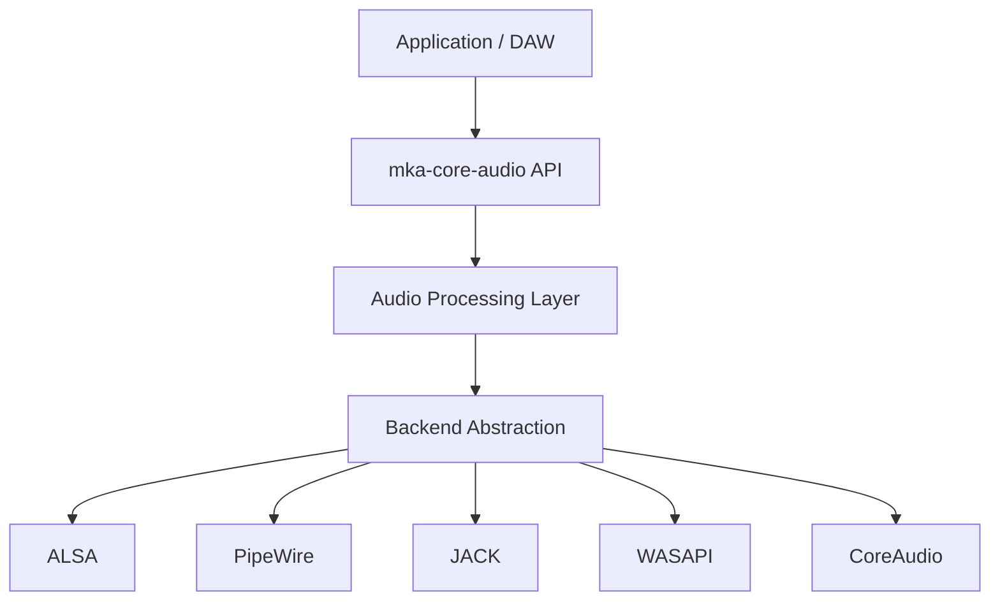

The application interacts only with the abstract audio interface.

Backend implementations are responsible for translating that interface into the native concepts of the underlying audio system.

---

# Backend abstraction

A backend should not force the rest of the framework to understand its own API.

For example:

* ALSA exposes PCM devices and hardware parameters.
* PipeWire exposes nodes and streams.
* JACK exposes ports and clients.
* CoreAudio exposes devices and streams.
* WASAPI exposes devices and audio clients.

These concepts are different, but the framework exposes them through a common abstraction.

The backend therefore becomes an implementation detail.

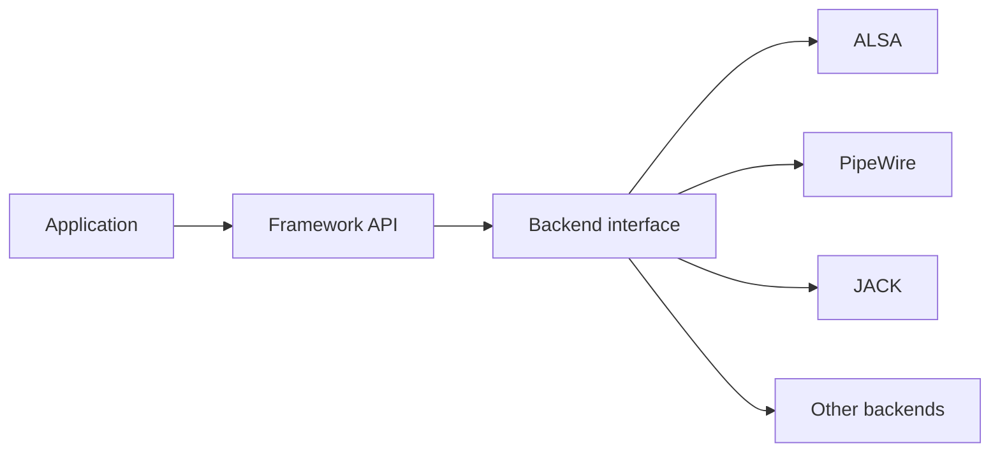

This makes it possible to change the audio backend without changing the audio engine itself.

---

# Endpoints

The framework models audio connections through **endpoints**.

An endpoint represents an audio input, output, or bidirectional connection exposed by a backend.

An endpoint may therefore be:

* input-only
* output-only
* input/output

Conceptually, an endpoint contains an identity and optional input/output capabilities. Direction is selected in `EndpointConfig`, not stored as a separate `Endpoint` field.

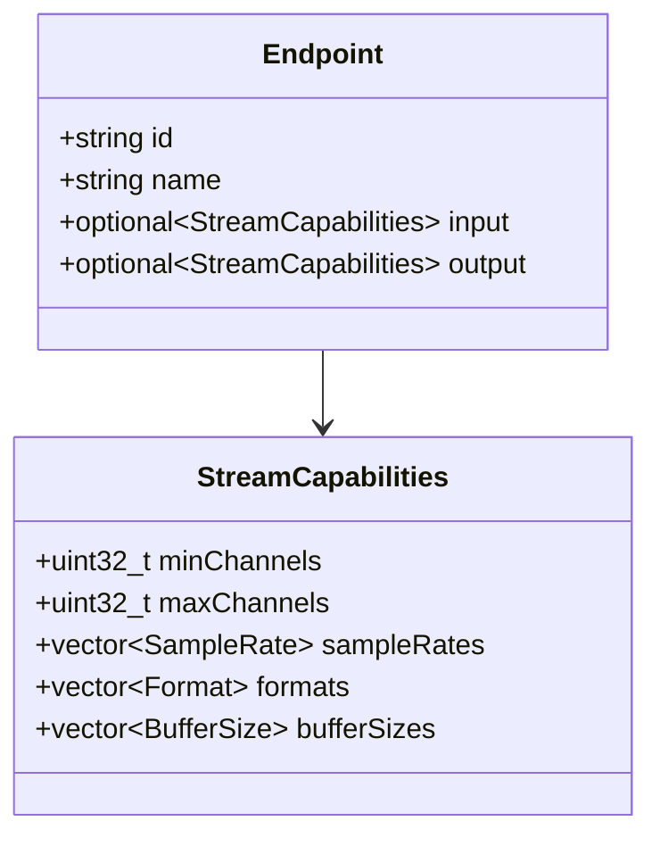

The framework does not require the application to construct large backend-specific device objects.

Instead, endpoint identity and capabilities are returned together through `Endpoint`.

---

# Endpoint discovery

Endpoint discovery is intentionally separated from opening an audio stream.

The endpoint list contains the information required to identify and configure each endpoint. Endpoint capabilities are therefore returned together with the endpoint rather than being queried through a second operation.

The general workflow is:

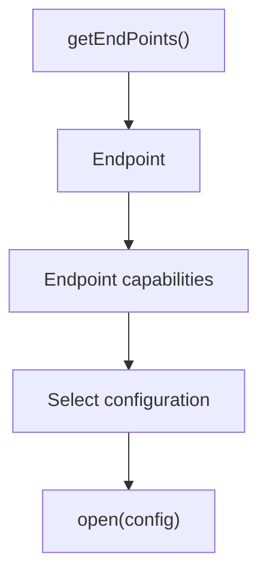

This avoids an unnecessary request for every endpoint and keeps endpoint enumeration simple for the application.

The application can therefore:

1. Retrieve the available `Endpoint` objects.
2. Inspect each endpoint's identity, direction and capabilities.
3. Select an endpoint and configuration.
4. Open the endpoint.

---

# Endpoint direction

An endpoint is not necessarily unidirectional.

The abstraction supports three possible directions:

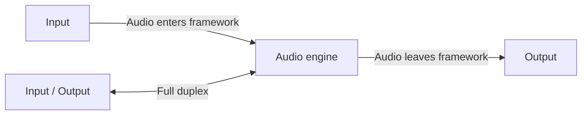

This allows a backend to expose a full-duplex audio endpoint without requiring separate input and output device abstractions.

---

# Endpoint discovery API

The endpoint discovery API exposes all currently available endpoints together with the information required to use them.

Conceptually:

```cpp
std::vector<Endpoint> getEndPoints();
```

Each `Endpoint` contains the endpoint identity, direction and capabilities. No additional `getEndpoint()` call is required for normal endpoint discovery.

The returned information is descriptive: it allows the application to choose a valid configuration before calling `open()`.

---

# Configuration

Opening a stream is based on an explicit configuration.

The application specifies the parameters it wants rather than relying on an implicit configuration chosen by the backend.

Typical parameters include:

* input channel count
* output channel count
* sample rate
* buffer size
* sample format
* selected endpoint

Conceptually:

```cpp
using namespace mka::audio::core;

EndpointConfig config{
    .id             = "...", // Endpoint::id returned by getEndPoints()
    .direction      = Direction::Output,
    .inputChannels  = 0,
    .outputChannels = 2,
    .sampleRate     = 48000,
    .format         = Format::Float32,
    .bufferSize     = 256
};
```

The backend is responsible for determining whether that configuration can actually be provided.

A configuration mismatch must be reported explicitly rather than silently changing the requested parameters.

This keeps the behavior deterministic and prevents the application from unknowingly running with a different audio configuration.

---

# Configuration negotiation

The framework intentionally distinguishes **capability discovery** from **configuration validation**.

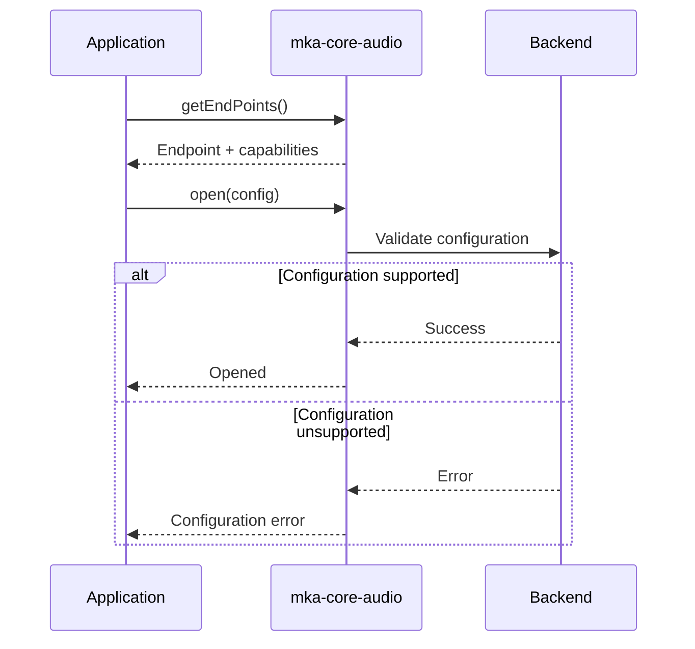

The framework does not silently replace an unsupported configuration with another configuration.

If negotiation or validation fails, the caller receives an explicit error.

---

# Supported sample formats

The framework defines a backend-independent representation of sample formats.

Currently considered formats include:

```text
Int16
Int24
Int32
Float32
Float64
```

The backend may use a native representation internally.


The goal is to keep DSP code independent from the hardware's native sample representation.

---

# Planar audio buffers

The framework uses a **planar channel representation** at the processing boundary.

Instead of interleaved samples:

```text
L R L R L R L R
```

audio is represented as independent channel buffers:

```text
Channel 0:
L L L L L L

Channel 1:
R R R R R R
```

Conceptually:

```cpp
float* channels[] = {
    left,
    right
};
```

The memory model can be represented as:

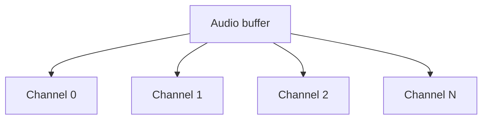

This representation has several advantages for DSP processing:

* direct per-channel processing
* predictable memory access
* easier SIMD/vectorization
* straightforward channel routing
* no interleaving/deinterleaving in DSP code

Backend-specific interleaved formats are converted at the backend boundary when necessary.

---

# Real-time processing

Real-time safety is one of the fundamental requirements of the project.

The audio processing path must be deterministic and must avoid operations that can introduce unpredictable latency.

The real-time path should therefore avoid:

* dynamic memory allocation
* deallocation
* mutex locking
* filesystem operations
* blocking I/O
* logging
* expensive system calls
* unbounded operations

The callback must operate only on resources prepared before the stream starts.

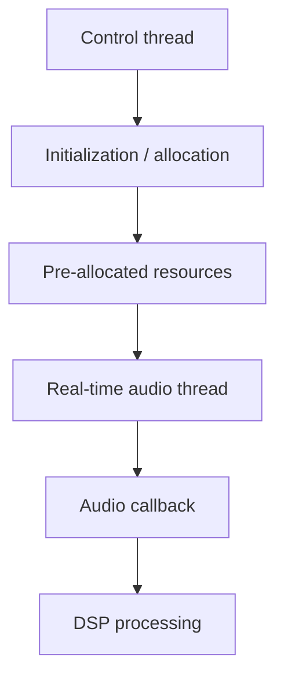

Anything requiring allocation or potentially blocking behavior belongs outside the real-time path.

---

# Backend buffer size and callback frames

`EndpointConfig::bufferSize` is a backend transport parameter, in frames per
channel. It is not a DSP block size. `AudioProcessContext::frames` is the actual
number of valid samples in **each channel** of the current callback. Consumers
must process exactly `[0, frames)` and read `frames` on every call.

* ALSA uses `bufferSize` as its period size, not the total native ring size.
* JACK checks the server quantum at open; callbacks carry the current `nframes`.
* PipeWire requests a node latency of `bufferSize / sampleRate`; native buffers
  and the graph quantum determine the actual callback length.
* PulseAudio uses `bufferSize` for its latency request and preallocated scratch
  capacity. Native requests are split into chunks of at most that many frames;
  the last chunk can be shorter.

Core Audio transports those frames without accumulating fixed DSP blocks. A DSP
engine needing fixed blocks must adapt them outside Core Audio. A latency request
is not a guarantee about end-to-end latency or callback scheduling.

---

# Callback

Once a stream is running, audio processing is performed through a user-defined callback.

Conceptually:

```cpp
setProcessFunction(callback, userData);
```

The callback receives the audio buffers for the current processing block.

A simplified representation is:

```cpp
struct InputBuffer {
    const float* const* channels;
    std::uint32_t count;
};
struct OutputBuffer {
    float* const* channels;
    std::uint32_t count;
};
struct AudioProcessContext {
    InputBuffer input;
    OutputBuffer output;
    std::uint32_t frames;
};
using ProcessFunction = void (*)(void* user, const AudioProcessContext&) noexcept;
```

The callback is executed from the real-time audio processing context.

Therefore, callback code must follow the same real-time constraints as the framework itself.

The callback processing flow is:

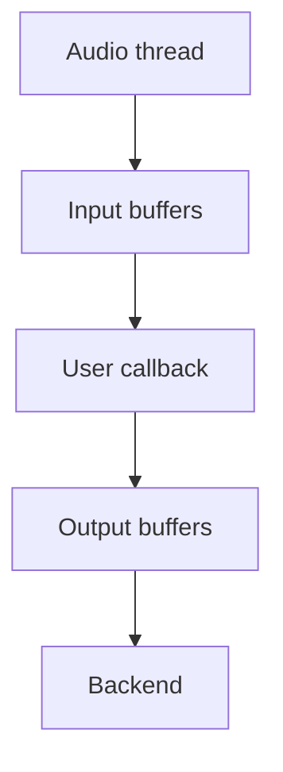

---

# Stream lifecycle

The stream lifecycle is deliberately small.

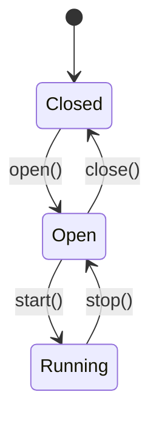

The intended public operations are:

```text
open()
start()
stop()
close()
```

## `open()`

Creates and configures the stream using the requested configuration.

It may perform:

* endpoint validation
* backend resource creation
* format negotiation
* buffer allocation
* internal initialization

It must not silently substitute incompatible parameters.

## `start()`

Starts real-time processing.

After `start()`, the callback may be invoked by the backend.

## `stop()`

Stops real-time processing while keeping the stream open.

## `close()`

Releases resources associated with the stream.

The public API is designed so that lifecycle errors are returned as explicit error results rather than being communicated through exceptions.

---

# Error handling

The audio API uses explicit result/error reporting for operations that can fail.

This is particularly important for lifecycle functions such as:

```text
open
start
stop
close
```

Errors may originate from:

* invalid state transitions
* unsupported configurations
* unavailable endpoints
* backend failures
* stream negotiation failures
* allocation failures
* runtime audio errors

The real-time callback should not use exceptions as a normal control-flow mechanism.

---

# Endpoint capabilities

Each endpoint exposes the capabilities supported by the underlying backend.

These capabilities may include:

```text
Sample formats
Sample rates
Channel counts
Buffer sizes
Input support
Output support
```

Conceptually:

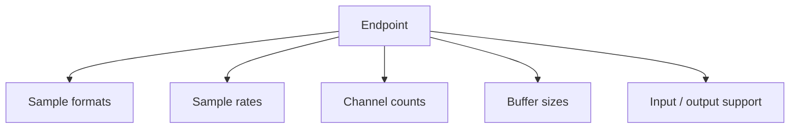

The project keeps the supported framework-level values centralized rather than duplicating them across every backend implementation.
The backend reports the subset supported by each endpoint through `Endpoint`.

This allows backend implementations to use the same definitions when reporting or validating capabilities.

---

# Linux backends

Linux is currently the primary development platform.

The project targets several Linux audio systems.

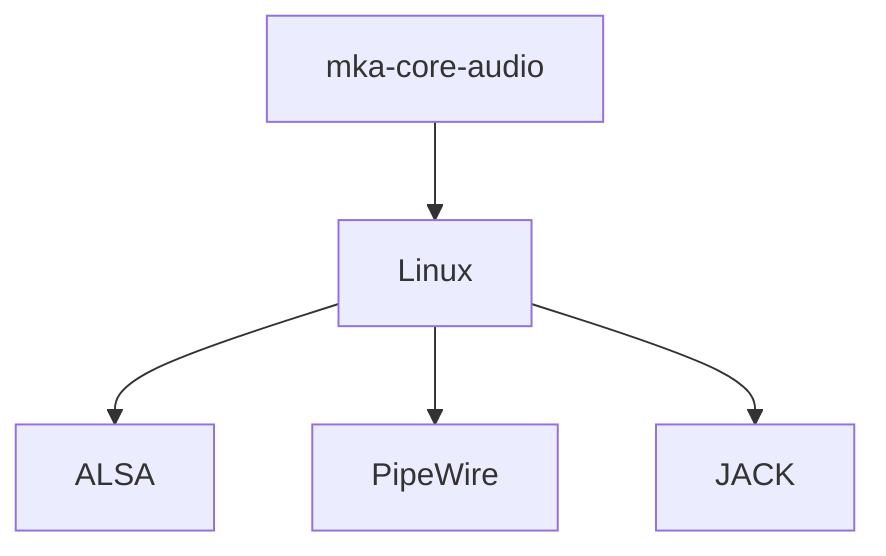

---

# ALSA

ALSA provides direct access to Linux PCM audio devices.

The ALSA backend is intended to provide:

* device enumeration
* hardware capability inspection
* full-duplex streams
* low-level buffer access
* mmap-based processing where appropriate
* native sample-format handling

ALSA is particularly useful when the framework needs direct and predictable access to an audio device.

A simplified architecture is:

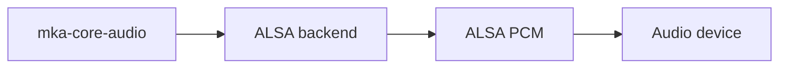

---

# PipeWire

PipeWire is supported as a higher-level Linux audio backend.

The backend uses PipeWire streams to integrate the framework with the PipeWire graph.

Conceptually:

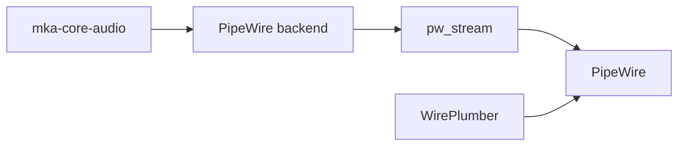

PipeWire may provide different timing and buffering characteristics from a directly controlled ALSA stream.

The backend therefore handles the required buffering and conversion internally so that the public framework interface remains consistent.

---

# JACK

JACK is part of the intended Linux backend architecture.

Its port-oriented model fits naturally with the framework's endpoint abstraction and is particularly useful for routing audio between professional audio applications.

The framework should expose JACK-specific functionality through the generic endpoint API rather than requiring the application to depend directly on JACK.


---

# Cross-platform backends

The architecture is intended to support additional native backends without changing the public audio API.

| Platform | Backend   |
| -------- | --------- |
| Linux    | ALSA      |
| Linux    | PipeWire  |
| Linux    | JACK      |
| Windows  | WASAPI    |
| macOS    | CoreAudio |

The exact implementation status of each backend may differ during development.

The abstraction is intentionally designed so that adding a backend does not require changes to the DSP layer.

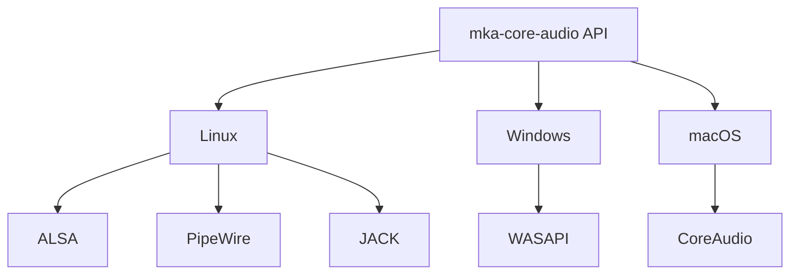

---

# Backend-independent design

A central design rule is:

> **Backend-specific code stays inside the backend.**

For example, DSP code should not contain:

```cpp
snd_pcm_*
pw_*
jack_*
IAudioClient*
AudioUnit*
```

Instead, it should only interact with framework-level concepts:

```cpp
Endpoint
StreamCapabilities
EndpointConfig
AudioProcessContext
Format
Result
ProcessFunction
```

The separation can be represented as:

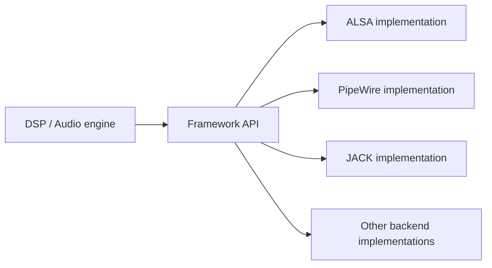

This keeps the audio engine portable.

---

# Threading model

The framework separates control operations from real-time processing.

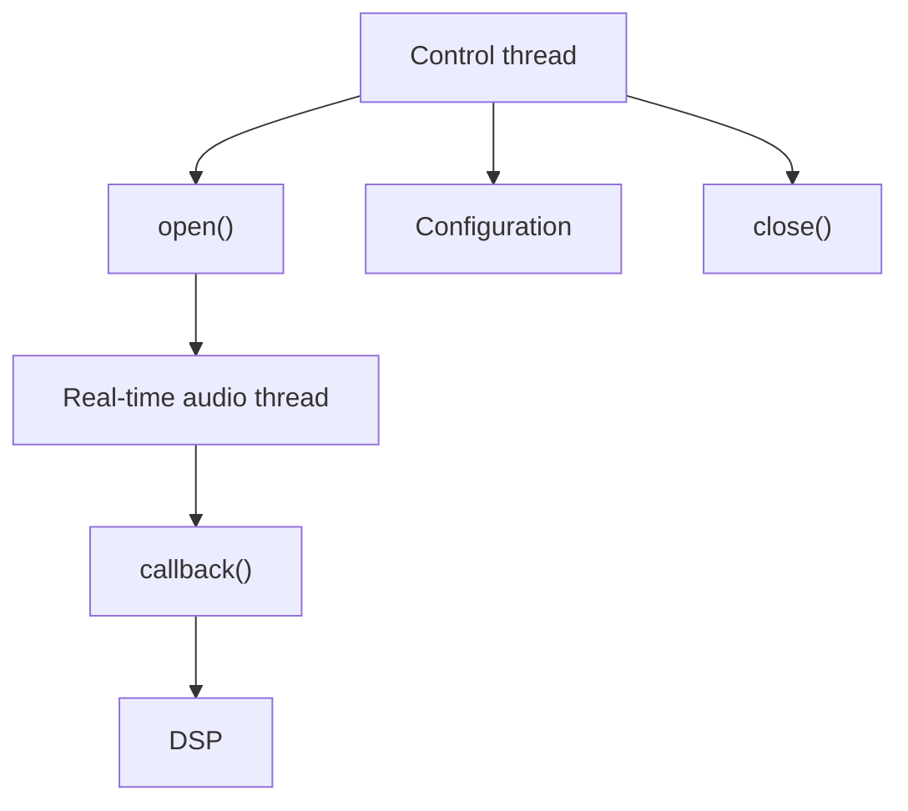

Control operations may allocate memory, communicate with the operating system and perform backend-specific setup.

The audio thread must operate on resources prepared beforehand.

---

# Control plane and audio plane

The architecture can be understood as two separate planes.

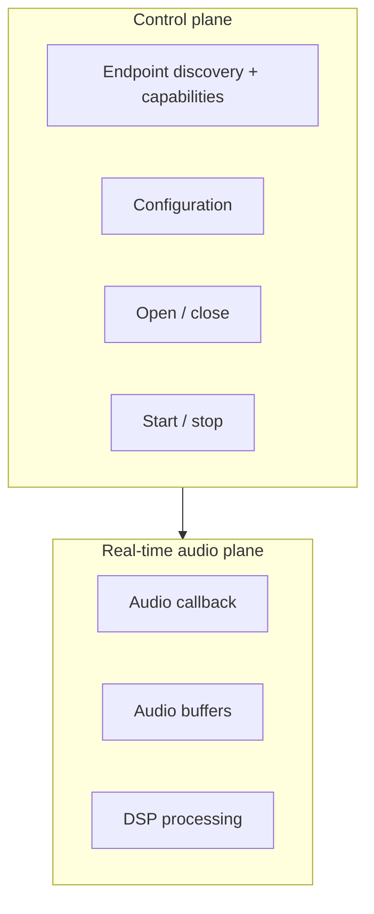

The control plane manages the lifetime and configuration of the audio system.

The audio plane processes samples under strict real-time constraints.

This separation is fundamental to the architecture.

---

# Project structure

The project is organized around a separation between the public abstraction and backend implementations.

A conceptual structure is:

```text
src/
├── abstract_core.cppm
│
├── utils/
│   ├── config.cppm
│   ├── constants.cppm
│   └── error.cppm
│
└── impl/
    ├── alsa_impl.cppm
    ├── pipewire_impl.cppm
    └── ...
```

The exact directory structure is expected to evolve with the implementation.

---

# C++ standard

The project targets modern C++ and currently uses **C++26**.

The implementation makes use of C++ modules to organize the framework.

The architecture is based around modules such as:

```text
audio.abstract_core
audio.config
audio.constants
audio.error
audio.alsa
audio.pipewire
...
```

The exact module organization may evolve as the project matures.

---

# Design principles

The project follows a few simple principles.

## KISS

Keep the public API small.

The framework should expose the concepts required by an audio engine without reproducing every concept of every backend.

## YAGNI

Backend-specific features should not become part of the abstraction unless they are genuinely required.

## Real-time first

Anything that can compromise deterministic audio processing must be isolated from the real-time path.

## Backend independence

The application should not need to know whether audio is ultimately provided by ALSA, PipeWire, JACK, CoreAudio or WASAPI.

## Explicit behavior

Configuration, state transitions and errors should be explicit rather than implicit.

## Pre-allocation

Memory required by the audio processing path should be prepared before entering the real-time state.

## Separation of responsibilities

Backend adaptation, buffer normalization and DSP processing are distinct responsibilities and should remain separate.

---

# Development status

The project is currently under active development.

The architecture is being established before expanding the number of supported backends.

Current development priorities include:

* [x] Define backend abstraction
* [x] Define stream lifecycle
* [x] Define endpoint-oriented architecture
* [x] Define combined endpoint information and capability model
* [x] Define configuration model
* [x] Define sample-format abstraction
* [x] Define callback model
* [ ] Finalize endpoint capability representation
* [ ] Finalize real-time buffer abstraction
* [ ] Implement complete ALSA backend
* [ ] Implement complete PipeWire backend
* [ ] Implement JACK backend
* [ ] Integrate external DSP block adaptation without adding it to Core Audio
* [ ] Add comprehensive backend tests
* [ ] Add real-time safety tests
* [ ] Add performance/latency benchmarks
* [ ] Add Windows backend
* [x] Add macOS backend (CoreAudio HAL; see native validation limits)

The API is expected to change while the architecture is being validated.

---

# Future architecture

The long-term goal is to use `mka-core-audio` as the foundation of a complete audio engine.

A possible future architecture is:

```mermaid
flowchart TD
    DAW["DAW"]

    PROJECT["Project"]
    UI["UI layer"]

    ENGINE["Audio engine"]

    GRAPH["Audio graph"]
    SCHEDULER["Scheduler"]

    CORE["mka-core-audio"]

    ALSA["ALSA"]
    PIPEWIRE["PipeWire"]
    JACK["JACK"]
    WASAPI["WASAPI"]
    COREAUDIO["CoreAudio"]

    DAW --> PROJECT
    DAW --> UI
    DAW --> ENGINE

    ENGINE --> GRAPH
    ENGINE --> SCHEDULER

    GRAPH --> CORE
    SCHEDULER --> CORE

    CORE --> ALSA
    CORE --> PIPEWIRE
    CORE --> JACK
    CORE --> WASAPI
    CORE --> COREAUDIO
```

The audio layer should remain independent from the higher-level DAW graph, UI and project-management systems.

---

# Why build another audio abstraction?

Existing audio frameworks solve many of the same problems, but this project has a different objective:

**to build the complete stack from first principles and maintain full control over the architecture.**

The project is therefore intentionally focused on:

* understanding the underlying audio systems
* controlling the real-time architecture
* minimizing abstraction overhead
* keeping the public API small
* learning how professional audio pipelines actually work
* creating a foundation that can later be integrated into a custom DAW

This is an engineering project as much as it is a reusable library.

---

# Non-goals

The project is not intended to:

* replace a DSP library
* provide a complete DAW by itself
* expose every feature of every backend
* hide all platform-specific behavior at any cost
* perform non-real-time audio processing inside the callback
* provide a GUI
* provide plugin hosting by itself

Those responsibilities belong to higher layers of the future audio stack.

---

# Performance philosophy

Audio performance is not measured solely by raw throughput.

The framework prioritizes:

1. deterministic execution
2. predictable memory access
3. bounded processing time
4. low latency
5. minimal synchronization
6. backend-independent behavior

A slightly more complex architecture is acceptable when it prevents backend irregularities from leaking into every DSP component.

The goal is therefore not simply:

```text
"process audio as fast as possible"
```

but rather:

```text
"process audio predictably, continuously and with bounded latency"
```

---

# License

License information has not yet been finalized.

`EndpointConfig::direction` requires Input: `inputChannels > 0`, `outputChannels == 0`; Output: `inputChannels == 0`, `outputChannels > 0`; Duplex: both counts greater than zero. Inconsistent counts return `ChannelsNotSupported` before any native resource is opened. Unknown direction values return `ConfigurationFailed`. Backend-specific channel limits still apply.

## Callback buffer lifetime

`InputBuffer::channels` is `const float* const*`; `OutputBuffer::channels` is
`float* const*`. Both are borrowed planar Float32 views, aligned for `float`.
Their pointer tables and samples remain valid only until the callback returns.
Do not retain/free them, modify the pointer tables, or hand them to other threads.
Every active channel is non-null and provides `frames` samples; an absent side
is `{nullptr, 0}`. Input is read-only and does not alias writable output. Output
starts as silence on every callback; write only `[0, frames)`. Without a callback,
output stays silent. Keep `user` alive until `stop()` returns, which quiesces the
callback. Control methods cannot be called from the audio callback.

## Strict stream configuration

`open(config)` validates and reserves the native application stream before
returning success, without invoking `ProcessFunction`. Its sample rate, format,
direction and channel counts must match the request; no nearest-value fallback is
allowed. A failure leaves the backend Closed and releases partial native resources.
The configuration is immutable until `close()`; change it with
`stop()` / `close()` / `open(newConfig)` / `start()`.

Strictness concerns the application stream boundary. A sound server may convert
between that stream and its hardware. `bufferSize` retains the backend-specific
meaning above: period for ALSA, initial server quantum for JACK, transport latency
request for PipeWire/PulseAudio. A latency request is not an exact hardware ring
size, graph quantum, callback length or end-to-end latency guarantee. Native
callback `frames` remains authoritative. JACK also rechecks the server rate and
quantum before start, because the server can change while the client is Open.

## Discovery snapshots and effective capabilities

`getEndPoints() const noexcept` runs on a control thread. It may allocate and
communicate with the audio server; `noexcept` does not make it real-time safe.
It returns a snapshot by value and reserves no resource. A missing `input` or
`output` means that direction was not exposed in this snapshot; it may be busy,
unavailable or unsupported. An empty endpoint list can also mean discovery failed;
the current interface has no separate discovery error channel.

| Backend | What discovery actually reports |
| --- | --- |
| ALSA | Native channel bounds and independent probes of the framework’s candidate rates, formats and period sizes. Busy/unqueryable streams can be omitted. |
| JACK | Current server rate/quantum and counts of audio ports grouped by client, with server output ports exposed as framework inputs. |
| PipeWire | Registry node identities and generic candidates: 1–2 channels, Float32, the framework’s rate and buffer-size lists. These are not per-node EnumFormat probes. |
| PulseAudio | Sink/source identities and reported server channel counts; Float32 plus the framework’s rate and buffer-size candidates. Server conversion may apply. |

The lists are neither exhaustive hardware capabilities nor a promise that every
combination works. `supportedSampleRates`, `supportedFormats` and
`supportedBufferSizes` are framework candidates, not proof of device support.
Never validate `open()` only against a cached discovery result: the native stream
must still be checked and can explicitly reject an advertised candidate.

## Result and error contract

`Result` is exactly `std::expected<void, ErrorType>`. Success is `Result{}` and
failure is `std::unexpected{ErrorType::...}`; there is no `None` enumerator.
`open`, `start`, `stop`, `close`, `setProcessFunction` and `setEventHandler` return it.

| ErrorType | Meaning |
| --- | --- |
| InvalidState | Operation forbidden in the current lifecycle state or from the event dispatcher. |
| EndpointUnavailable | Endpoint/server absent, inaccessible or disconnected. |
| FormatNotSupported | Unknown or unsupported requested stream format. |
| ChannelsNotSupported | Inconsistent direction/counts or unsupported channel count. |
| SampleRateNotSupported | Zero rate or requested stream rate not provided exactly. |
| BufferSizeNotSupported | Zero size or unsupported backend transport parameter. |
| ConfigurationFailed | Other native setup failure, unknown direction, or exception from a control hook. |

Lifecycle guards run first. Common configuration validation runs before native
resources are acquired. Do not rely on a backend-independent ordering of other
errors when multiple fields are invalid. Hook errors are forwarded unchanged;
hook exceptions become `ConfigurationFailed`, without advancing the lifecycle
state. Native hooks must release any partially acquired resource on failure.

Asynchronous xruns and stream loss use `Status::xruns` / `Status::failed` and
`EventType::XRun` / `EventType::Failed`, not Result returns from a callback.
After stream loss, the control thread calls `stop()` then `close()` before
reopening. A realtime-priority refusal is a `RealtimeState::No` fallback, not an
opening error. Discovery errors retain the existing empty-vector convention.

## Duplex model by backend

`Direction::Duplex` addresses **one endpoint ID** with positive, independently
chosen input/output counts. Both directions share one configuration and one
`AudioProcessContext` per cycle. Optional capabilities in both directions do not
alone prove that a simultaneous opening is possible.

| Backend | Endpoint ID and current duplex contract |
| --- | --- |
| ALSA | One PCM ID (normally `hw:X,Y`) opened for capture and playback. Both exact configurations and `snd_pcm_link` must succeed. A link failure returns `ConfigurationFailed` and closes both handles; no unsynchronized fallback. |
| JACK | One client name whose output ports feed framework input and whose input ports receive framework output. Both port groups must have enough channels. One server cycle supplies one duplex callback. Empty ID creates unconnected client ports. |
| PipeWire | One source or sink node name; a valid Duplex request returns `ConfigurationFailed` before native stream creation. Input and Output are supported separately. |
| PulseAudio | One source or sink name; a valid Duplex request returns `ConfigurationFailed` before native stream creation. Empty ID selects the default device for the requested single direction. |
| Windows | WASAPI shared-mode input/output; duplex requests are rejected. |
| macOS | CoreAudio HAL Float32 input/output or duplex on one device/clock; no implicit aggregate device. |

ALSA does not combine unrelated capture/playback devices; JACK can expose both
port groups under the same client ID. Two unidirectional backend instances do not
constitute a synchronized duplex stream and provide no shared clock/latency
guarantee. Coordinating unrelated endpoints or adding duplex server backends is
outside this contract and does not add a DSP graph to Core Audio.

Before native acquisition, channel counts must fit a native signed `int` and a
`size_t` pointer table. Each direction's requested Float32 buffer byte length
must fit both `uint32_t` (native transport lengths) and `size_t`; multiplication
is checked by division before allocation. Native device limits still apply.

Discovery and lifecycle hooks on one backend are serialized on the control
mutex; audio callbacks and `status()` never acquire it. Call discovery from a
control thread. Discovery from the event dispatcher returns an empty snapshot,
just as failed discovery does; handlers should post requests to the control thread.

Backend destruction runs on a control thread while external callers are quiescent.
Derived destructors first call the protected `stopDispatcher()` to join event
handlers while derived resources are alive, then stop/join native audio and
release buffers. The base destructor cannot perform virtual native cleanup.
Handler and process user data must outlive this shutdown; destruction from a
handler or audio callback is unsupported.

`status()` reads independent lock-free atomics. Its fields are safe to read
concurrently but are not a transactional snapshot of one instant; counters reset
at each start, so monotonicity applies only within a run.

Dispatcher shutdown requests cancellation and wakes its stop-token-aware wait
immediately. It joins an in-flight handler before returning and cancels pending
delivery. Handlers must finish promptly: a blocking user handler cannot have a
hard shutdown deadline without abandoning live user data. No thread is detached.

ALSA requires an exact period of `bufferSize` frames. The native ring uses at least
two whole periods; three are preferred, but the count follows the hardware
constraints (for example, the AMD acp63 capture driver requires four). It reads
back the rate, period, negotiated period count and ring size after applying
hardware parameters. A rounded callback period, fractional ring or inconsistent
readback returns `BufferSizeNotSupported`; failed native readbacks return
`ConfigurationFailed`. The negotiated ring count does not change the callback size.

An ALSA mmap chunk with no frames or an invalid ring range is treated as an xrun,
not retried in a tight transfer loop. Recovery drops/prepares/prefills/restarts the
stream. Device loss fails immediately; repeated recovery failures terminate the
stream and leave diagnostics available for the control thread's stop/close cycle.

PipeWire input chunks are checked for alignment, Float32 stride, mapped bounds
and corruption before exposing borrowed sample pointers. Corrupted chunks count
as xruns and do not reach the process callback. Rewritten output chunks clear
stale native flags and describe only the initialized frames.

PipeWire terminal states disable user processing before publishing failure. A new
native stream starts with fresh native readiness/failure flags; previous stream
loss cannot poison the next open. `stop()` still waits for any in-flight process
callback before its user data can be replaced or released.

PulseAudio reads the negotiated buffer attributes once the native stream is ready.
The effective playback length or capture fragment must contain whole frames and
fit the server's maximum. Server rounding remains allowed: `bufferSize` requests
latency, while callback frames stay bounded by preallocated scratch capacity.

PulseAudio control waits, including discovery context/list operations, have a
five-second deadline per phase. Timed-out operations are cancelled under the
native loop lock before their callback state is destroyed. Discovery returns its
existing empty-snapshot result on timeout or query failure; no exception escapes
its C callbacks. These waits remain outside the process callback.

PulseAudio conversions expose only whole frames within both scratch capacity and
the current write request. Capture fragments can span several bounded callbacks;
holes and trailing partial frames count as xruns. A failed capture drop disables
processing and reports failure instead of retrying the same fragment forever.

For reproducible Linux tests without hardware, install the ALSA, JACK, PipeWire,
WirePlumber and PulseAudio development/runtime tools, then run a test command in
private virtual servers:

```sh
bash test/linux/run_virtual_tests.sh ctest --test-dir build --output-on-failure \
  -R '^(pipewire|jack|pulseaudio|probe)\.|^alsa\.(contract\.|ALSARtContractTest\.|ALSABackendTest\.(OpenValidates|Unlinkable))'
```

The harness owns its temporary runtime directories, named JACK server, null
sink/source and continuous silent capture source, and stops them on exit. Set
`MKA_KEEP_TEST_LOGS=1` to retain fixture logs. The legacy ALSA tests tied to
`hw:1,0` still require that physical device and are outside this virtual suite.
Allocation-probe self-tests check ordinary, array, nothrow and aligned C++ `new`,
and glibc malloc/calloc/realloc/free on a marked audio thread. Run their native
checks separately from sanitizer builds, which use their own allocator runtime.
PulseAudio remains a non-RT server backend; these checks do not promise that
libpulse itself avoids internal allocation or locking.

The virtual PipeWire clients use the fixture's non-RT client configuration and do
not load RTKit. In this runtime, a minimal SDK-only context create/destroy cycle
retains allocations from that optional module; the non-RT fixture removes that
dependency without disabling LeakSanitizer. Production client configuration and
backend scheduling behavior are unchanged. Hardware and RTKit priority grants
require separate platform testing.

CTest labels select test requirements: `unit` needs no running audio server or
physical device; `integration` exercises native SDKs; `server`/`virtual` can run
with `test/linux/run_virtual_tests.sh`; `hardware` requires the physical ALSA
fixture `hw:1,0`. Missing fixtures are explicit GoogleTest skips. `manual` marks
disabled interactive scenarios; `rt` identifies callback/allocation checks and
`nonrt` the pure control tests. For example, use `ctest -L unit` or run native
checks with `ctest -L integration -LE hardware` inside the virtual harness.

For the same SDK-independent C++26 configuration used by CI, install Clang 19
with libstdc++ 14, CMake 4+ and Ninja, then run:

```sh
CXX=clang++-19 cmake --preset core
cmake --build --preset core --parallel 2
ctest --preset core
```

The preset disables all native backends. A library-only build with
`MKA_BUILD_TESTS=OFF` does not fetch or configure GoogleTest. CI uploads CTest's
JUnit results and logs even when the test step fails.

CI's Linux option matrix enumerates all 16 combinations of
`MKA_BUILD_ALSA`, `MKA_BUILD_JACK`, `MKA_BUILD_PIPEWIRE` and
`MKA_BUILD_PULSEAUDIO`; `python3 ci/linux_matrix.py` prints the same matrix for
local tooling. Each job compiles its enabled targets and runs unit tests. Jobs
with native backends also execute integration tests on the private virtual
servers, with physical hardware cases excluded. The harness owns its D-Bus
session as well as the audio servers, so it supports WirePlumber versions that
require a session bus without borrowing the host session.

Use the `asan` configure/build/test presets for combined ASan/UBSan checks of
the core. `MKA_SANITIZER=address-undefined` applies to compilation and linking;
UBSan errors fail the run. Leak detection stays enabled. Allocation-interposition
and native RT probe sources are omitted in sanitizer builds; their ordinary
build remains the place to verify allocation counts. An unknown sanitizer mode
is a configuration error.

ThreadSanitizer is a separate mode: configure/build/test with `--preset tsan`
(or set `MKA_SANITIZER=thread`). It runs the SDK-independent `nonrt` control
suite, including concurrent state changes and event dispatch; `rt` tests and
allocator interposition are excluded. Native audio SDKs are not instrumented by
this job, so its result does not establish race freedom inside those libraries.
Sanitizer modes are mutually exclusive; findings fail the CTest/CI step.

`ctest -L stress` exercises 1,000 complete core open/start/stop/close cycles on
the same backend instance, with real worker and event-dispatch threads. Every
cycle verifies callback progress, invalid transitions, joined workers and zero
live resources, then frees both user contexts before reopening. The stress cases
also run in the core ASan/UBSan and TSan presets; they are a core lifecycle test,
not a substitute for native-device endurance testing.

The core already converts hook exceptions to `ConfigurationFailed` and preserves
the preceding lifecycle state. Rollback tests exercise `std::bad_alloc`, standard
and non-standard exceptions at every lifecycle hook and discovery, including
pending allocations and threads. A hook owns cleanup of resources acquired
before throwing; the base cannot release SDK-specific partial state. Successful
retry, user-context preservation and quiescence are checked under both sanitizers.

Conversion edge cases are tested for every layout with unaligned, strided buffers
and byte canaries. Integer writes sanitize NaN to zero and saturate infinities;
float writes keep headroom, infinities and signed zero while sanitizing NaN.
Float reads preserve NaN; Float64 values outside the finite Float32 range become
signed infinity. Zero-frame calls may use null pointers, and a one-frame call
never uses its stride to form an unused next pointer. Callers must provide valid
storage for every sample actually accessed.

To produce the same source coverage report as CI, use Clang with matching
`llvm-cov`/`llvm-profdata` tools and run:

```sh
cmake --preset coverage
cmake --build --preset coverage --parallel 2
```

The `coverage` target executes the real core CTest suite and generates
`build/coverage/coverage/html/index.html`, `lcov.info`, `report.txt`, a JSON
summary, merged profile and JUnit results. CI uploads these as `core-coverage`,
including diagnostics on failure. Only `src/core/*.cppm` is measured; tests,
GoogleTest, native SDKs and backends are excluded from the report. Modules with
no executable regions are listed separately, without a fabricated percentage.
Each run uses fresh raw profiles; failed tests fail the target even when a report
can still be generated. Coverage and sanitizers use separate builds.

On Windows, use Visual Studio 2022 17.14+ with the C++ toolset and Windows SDK,
CMake 4+ and Ninja. In an x64 Developer Command Prompt:

```bat
cmake --preset windows-core
cmake --build --preset windows-core --parallel 2
ctest --preset windows-core
```

This SDK-independent configuration uses MSVC `/std:c++latest`, the existing
C++ module file set and the same dynamic CRT for the library and GoogleTest.
The Windows CI job runs the same positive and negative core contract tests;
Linux-only allocator interposition is not part of this Windows preset.

`MKA_BUILD_WASAPI` selects the Windows-only `mka-audio-wasapi` target, linked to
`ole32` and `uuid`. Use the `windows-wasapi` configure/build/test presets for this
target. Import `mka.audio.backend.wasapi` for `mka::audio::core::Wasapi`; the
original empty module name `wasapi` remains available as a compatibility import.
Requesting WASAPI on a non-Windows target fails explicitly during configuration.
CMake currently recognizes MSVC's `/std:c++latest` under `cxx_std_23`, not
`cxx_std_26`; the Windows build uses that CMake feature while compiling in
`/std:c++latest` draft mode. Other compilers continue to require `cxx_std_26`.
This does not claim that MSVC implements every future C++26 language feature.

WASAPI owns a persistent COM MTA on a dedicated non-RT control thread. Discovery,
configuration and native interface release run there, regardless of the caller's
apartment. Both S_OK and S_FALSE are balanced by CoUninitialize on that same
thread; failed initialization never uninitializes COM. This control queue is
separate from the audio worker and is never used by a process callback.

WASAPI discovery reports active capture/render IDs and their native mix-format
channels, sample rate and representation. Default device periods become bounded,
rounded-up frame-count latency hints. Failed or malformed mix-format queries are
not replaced with invented capabilities. This is a conservative snapshot; open
revalidates the exact requested configuration. A shared mix layout is not a
promise that every channel/rate/format combination is supported.

WASAPI opens the requested active render or capture endpoint, or the OS console
default when its ID is empty. Native acquisition is transactional and runs on the
COM owner; failed lookups or activation leave the backend closed and reusable.
Capture and render use separate instances; a duplex request is rejected. Control
commands use a synchronous stack-resident slot, so native teardown does not need
to allocate another work item.

WASAPI shared-mode format negotiation accepts only `IsFormatSupported == S_OK`.
A closest match (`S_FALSE`) is freed and rejected; rate, channels and portable
format are never silently substituted. WAVEFORMATEXTENSIBLE sizes, byte-rate
arithmetic and speaker masks are checked. Int24 retains a most-significant-bit-aligned 24-in-32
container when the native mix uses it; otherwise the request uses packed 24-bit.

Shared WASAPI initialization uses the exact validated format, event-callback flag,
zero periodicity and the requested frame count converted to a rounded-up
REFERENCE_TIME duration. Native buffer capacity is read back and bounded before
use. `bufferSize` requests latency; it is not a fixed DSP callback size. Failed
initialization or malformed capacity releases the pending client and allows retry.

A shared render stream registers its own auto-reset audio event and acquires
IAudioRenderClient before open succeeds. Event creation, registration and service
failures release the pending handles/interfaces. Open does not acquire audio
buffers or call the process function; the native client is released before its
event handle is closed.

Capture acquires IAudioCaptureClient and consumes only bounded native packets.
Each successful GetBuffer has exactly one ReleaseBuffer, including rejected
packets; empty/failed acquisitions are not released. SILENT packets may have a
null data pointer. Non-silent null data, oversized frames and unknown flags never
reach processing. Borrowed native bytes remain valid only until ReleaseBuffer.

The WASAPI process bridge uses preallocated planar Float32 storage and borrowed
pointer tables for the active direction; the inactive side is null with count
zero. Output is silent before each callback, native padding bounds render frames,
and capture frames are bounded by native capacity. Conversion reuses the core
converters. WAVEFORMATEXTENSIBLE PCM24 in a 32-bit container is high-aligned (unlike
ALSA's low-aligned S24In32); its adapter shifts the valid bits explicitly and
ignores input padding. No conversion buffer is allocated on the audio path.

Start prepares an MTA processing worker and silent render prefill before starting
the native client. User processing is enabled only after native Start succeeds;
startup failure signals and joins the pending worker. The audio loop waits on its
native audio/stop events outside processing. MMCSS Pro Audio registration is
optional and reported through the existing RealtimeState status. Stop disables
new processing, wakes and joins any in-flight callback before native Stop/Reset.
Close/destruction force quiescence before releasing COM interfaces or buffers.

Terminal WASAPI errors (including device/resource invalidation and a stopped audio
service) disable processing before Failed is published once through the existing
status/event mechanism. A 100 ms health check can detect invalidation even when
the device stops signaling audio events; it never calls DSP from a timeout.
Temporary BUFFER_ERROR and capture discontinuities count as xruns. Stop/close
still release an invalidated stream, and a new start resets native failure state.

The Windows suite includes the public WASAPI error/status/event contract, 1,000
complete lifecycle cycles, controlled SDK failures, C++ allocation probes and
separate hardware cases. See [WASAPI validation](docs/sprint05-validation.md).
`windows-wasapi-asan` selects MSVC AddressSanitizer (`MKA_SANITIZER=address`),
without incompatible runtime checks or allocator interposition. The CI validates
its flags and a negative runtime witness; it does not claim Windows UBSan/TSan/LSan.

WASAPI remains shared-mode in production. The sprint's read-only
[exclusive assessment](docs/wasapi-exclusive-assessment.md) queries exact native
formats and periods without reserving a device; hardware results or explicit
unavailable-device skips are recorded by the Windows suite. Exclusive runtime
selection requires a separate portable API decision and is not silently enabled.

For direct ALSA sine/record-and-replay tests, use the separate audio test executable
and explicit input/output PCMs. See [manual ALSA diagnosis](docs/manual-alsa.md)
for commands, signal levels, bounded waits and hardware mixer/ownership checks.

On macOS, use CMake 4+, Ninja and upstream LLVM (`brew install llvm ninja cmake`).
AppleClang currently lacks CMake's required named-module dependency scanning;
configuration reports this limitation rather than disabling module validation.
The `macos-core` preset requires no audio SDK and uses the same C++26 core tests:

```sh
CXX="$(brew --prefix llvm)/bin/clang++" cmake --preset macos-core
cmake --build --preset macos-core --parallel 2
ctest --preset macos-core
```


`MKA_BUILD_COREAUDIO` enables the macOS-only `mka-audio-coreaudio` target and links
CoreAudio/CoreFoundation. Import `mka.audio.backend.coreaudio` for
`mka::audio::core::CoreAudio` (`coreaudio` is retained as a compatibility import).
Use the `macos-coreaudio` configure/build/test presets for native SDK unit tests
and `macos-coreaudio-asan` for ASan/UBSan. Requests use a device UID from discovery
(or an empty UID for the system default), native channel counts and Float32.
Capture requires microphone permission for the host application/terminal.
See [CoreAudio validation and transport limits](docs/sprint06-validation.md) for
supported layouts, exact rate/buffer handling, hardware tests and RT evidence.

Backend availability comes from `import mka.audio.backend.plateform` (the historical
module spelling is preserved). `knownBackends` lists all stable identifiers;
`supportedBackends` and `isBackendCompiled()` describe the implementations enabled
in this library's CMake build. A core-only build has an empty supported list on
all operating systems. ASIO, WMME and DirectSound remain known enum values and
empty source stubs; they are never advertised as compiled/operational backends.
Availability does not guarantee a running service, a device or permission to open it.
